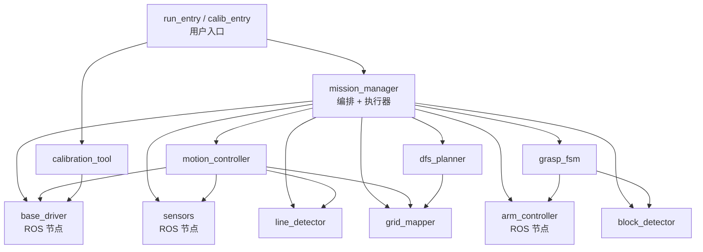
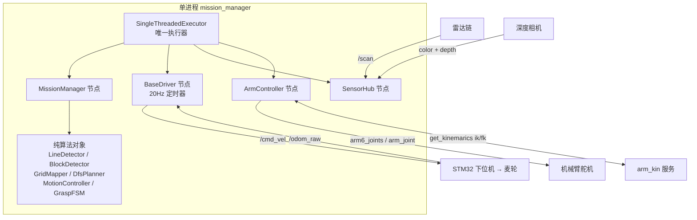
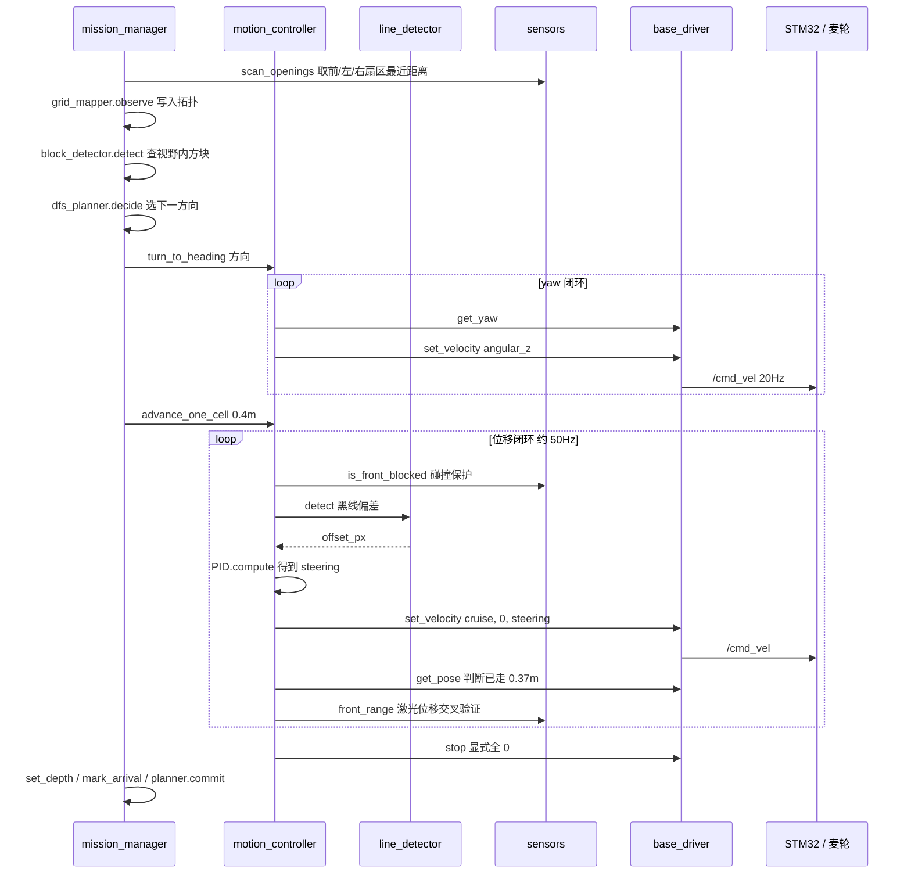
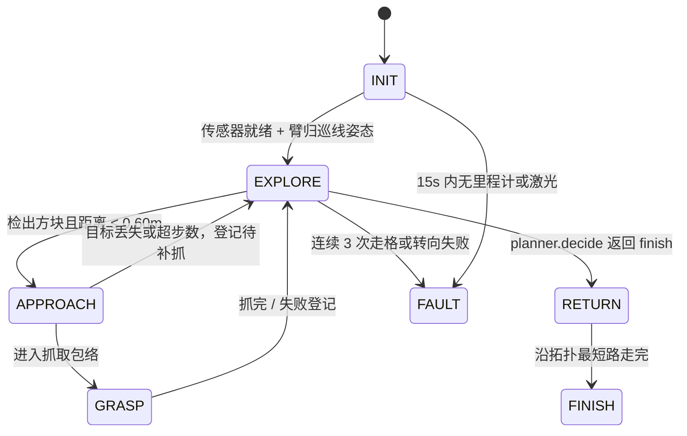

# M3Pro 迷宫系统 — 架构与控制框架

> 目的：给出**从上到下**的一页式框架——谁调用谁、谁驱动谁、一条指令如何变成轮子转动、如何启动。
> 事实来源：`/home/jetson/yahboomcar_ws/src/maze_explorer` 源码（行号已标注）与 2026-10-03 实测（pytest 75/75、colcon build 通过）。
> 配套文档：`AGENTS.md`（硬件接口事实）、`PLAN.md`（设计与决策）、`README.md`（入门）。

---

## 一、六层视图（自顶向下）

| 层 | 模块 | 是否 ROS 节点 | 职责 |
|---|---|---|---|
| ① 入口层 | `run_entry.py`（`maze_run`）、`calib_entry.py`（`maze_calib`） | 否（内含探针节点） | 自检 / 菜单 / 关手柄自启 / 转交 launch |
| ② 编排层 | `mission_manager.py` | **是**（并持有 3 个子节点） | 顶层状态机、DFS 推进、遇块即抓、返航 |
| ③ 控制层 | `motion_controller.py`、`grasp_fsm.py` | 否（纯逻辑类） | 走格 / 转向 / 横移 / 抓取序列 |
| ④ 感知层 | `line_detector.py`、`block_detector.py` | 否（各附一个调试节点） | 黑线偏差、四色方块三维定位 |
| ⑤ 建图决策层 | `grid_mapper.py`、`dfs_planner.py` | 否（`grid_mapper` 附调试节点） | 7×7 拓扑、DFS 选向、BFS 返航 |
| ⑥ 硬件抽象层 | `base_driver.py`、`sensors.py`、`arm_controller.py` | **是**（三个节点） | `/cmd_vel`、`/odom_raw`、RGB-D、`/scan`、关节与 IK；**含速度看门狗与传感器保鲜度** |

要点：③④⑤ 全是**不依赖 ROS 的纯 Python 类**，因此可离线单测（`test/` 1015 行覆盖的就是它们）；只有 ⑥ 和 ② 碰 ROS。调试用的 `*Node` 类（`LineDetectorNode`/`BlockDetectorNode`/`GridMapperNode`）**不在主流程里**，只为单独跑一跑看输出。安全保护见 [`SAFETY.md`](SAFETY.md)。

---

## 二、静态依赖图（import 关系，实际抓取）



- 无环：`mission_manager` 是唯一的总装点（`mission_manager.py:35-48` 一次导入全部 9 个模块）。
- `dfs_planner` 只依赖 `grid_mapper`，两者都不碰 ROS，可离线跑全量单测。
- 唯一的"反向"依赖：`calibration_tool` 复用 `base_driver.yaw_from_quaternion`（`calibration_tool.py:48`）。

---

## 三、运行时对象图：谁创建谁、谁驱动谁



**执行模型（本项目最关键的设计，也是 B1 缺陷的修复点）**

1. `MissionManager.__init__` 在**自己进程内** new 出 `BaseDriver`、`SensorHub`、`ArmController` 三个节点，并全部 `add_node` 到同一个 `SingleThreadedExecutor`（`mission_manager.py:122-180`）。
2. 主循环 `run()` 是**同步阻塞**的（`mission_manager.py:341-371`），没有 `rclpy.spin`。
3. 所有阻塞式运动/抓取原语内部靠 **注入的 spin 回调** 驱动回调：
   `MotionController(spin_fn=self._spin)`（`mission_manager.py:157`）→ `motion_controller._spin_once()`（`motion_controller.py:252-260`）→ `executor.spin_once()`。
4. IK/FK 的服务 future 同理走注入的 `spin_until_fn`（`arm_controller.py:101,277`），否则会抛
   "Node has already been added to an executor"。

> ⚠️ 结论：**任何绕过 `_spin_once` 直呼 `rclpy.spin_once` 的写法，都会让 `/odom_raw`、`/scan` 回调停止更新**，闭环立刻失效（历史上表现为"原地转到超时"）。改动运动原语时必须守住这条。

---

## 四、ROS 接口与硬件通道（代码实际注册的）

| 节点 | 发布 | 订阅 | 服务客户端 | 定时器 |
|---|---|---|---|---|
| `BaseDriver` | `/cmd_vel` `Twist` | `/odom_raw`、`/odom`（备用航向） | — | **20Hz** 重发缓存速度（`base_driver.py:432-434`） |
| `SensorHub` | — | `color` + `depth`（`ApproximateTimeSynchronizer`, slop 0.08）、`/scan` | — | 20s 帧率日志（`sensors.py:49,124`） |
| `ArmController` | `arm6_joints`、`arm_joint` | — | `get_kinemarics`（ik/fk） | — |
| `MissionManager` | — | — | — | — |
| `run_entry._Probe` | — | `/odom_raw`、`/scan`、`/camera/color/image_raw` | `get_kinemarics` | — |

`/cmd_vel` **无超时停车保护**，因此速度不是"发一次就走"，而是**写入缓存后由 20Hz 定时器持续重发**（`base_driver.py:303-323,432-434`）；停止 = 显式写全 0。

---

## 五、一条指令如何变成轮子转动（走一格全链路）



细节（`motion_controller.py`）：

- **走格**：目标位移 = `cell_size − tolerance` = 0.40 − 0.03 = 0.37m（`:430`）；到位判据取「里程计位移」与「前墙距离减少量」的**较小值**，抑制积分漂移冲过头（`:495-503`）；前方无回波则自动跳过该交叉验证。
- **转向**：目标角 = `期望转角 / ang_scale`（**除法**，`:543`），P 控制 + 0.12rad/s 静摩擦补偿（`:556-561`），容差 0.0873rad ≈ 5°。
- **丢线保护**：连续 5 帧无黑线 → 停车返回 False（`:217-223`），由上层计入失败。
- **碰撞保护**：前扇区 0±15° 最近距离 < 0.25m → 停车 + 后退半格（`:202-208,327-343`）。
- **传感器门禁（2026-10-03 新增）**：动作前与每个控制周期各查一次保鲜度——
  激光年龄 > 0.5s 一律不动（失效时 `sector_min_range` 返回 `None`，而开口判定与
  碰撞保护都把 `None` 当"通畅"）；前进还要求相机年龄 ≤ 2.0s（失效时循迹偏差恒 0，
  车会闷头直行）。详见 [`SAFETY.md`](SAFETY.md) §七。

---

## 六、抓一块方块的全链路

由 `EXPLORE` 检测到方块触发，两段：


`GraspFSM._run_sequence` 的九步（`grasp_fsm.py:238-328`）：

| 步 | 动作 | 下发 | 用时（按 `arm_poses.yaml` 计算） |
|---|---|---|---|
| PREPARE | 张开夹爪 joint6=30 | `arm_joint` | 1.2s |
| SOLVE | FK 取当前姿态 → IK 求关节角 | `get_kinemarics` | ≤2s 超时 |
| DESCEND | 下探到目标（tar_x + 0.03 前向补偿，roll=π） | `arm6_joints` | 2.0 + 0.3s 静置 |
| CLOSE | 夹紧 joint6=120 | `arm_joint` | 1.2 + 0.3s |
| LIFT | joint2 抬到 120 | `arm6_joints` | 2.0s |
| PLACE | 移到收集筐位姿 | `arm6_joints` | 2.0s |
| RELEASE | 张开 | `arm_joint` | 1.2 + 0.3s |
| RETREAT | 回巡线姿态（相机恢复看地） | `arm6_joints` | 2.0s |
| — | 失败重试 1 次，二次失败登记待办 | | |

> **单块 ≈ 13s（计算值，非实测）**，与 `PLAN.md` §三 的 6~8s 目标有差距：源头是 `move_time_ms=2000` 恒定下发，未实现"按关节距离自适应 600~1200ms"（`arm_poses.yaml:47`，`grasp_fsm.py:102`）。8 块累计 ≈ 104s，是全场最大耗时项。

抓取依赖三个前提：① 定位在**巡线姿态**下完成（相机装在 arm4 上，臂动视角就变）；② 方块水平距离落在 0.13~0.25m；③ 相机外参 `mount_calibrated` 为真，否则退化为相机系近似（`grasp_fsm.py:252-258`）。

---

## 七、顶层状态机（`mission_manager.py:70-79`）



- `run()` 每轮取当前状态的 handler，用返回值作为下一状态，状态迁移打一条 INFO（`:252-261`）。
- `EXPLORE` 一个周期 = 观测路口 → 查方块 → DFS 决策 → 转向 → 走格（`:296-347`），即**一个状态周期前进一格**。
- `FAULT` 是**终态**：退出前 `base.stop()`，打印 `planner.summary()`（`:263-267`）。
- 设计文档里的 `DETECT`（已并入 EXPLORE）与 `DEGRADE`（未实现）不在此枚举内，详见 §十。

---

## 八、启动流程

### 8.1 环境（每次都必需）

```bash
export ROS_DOMAIN_ID=30                                  # 不设则看不到任何话题
source /opt/ros/humble/setup.bash
source /home/jetson/yahboomcar_ws/install/setup.bash     # 相机 / 机械臂 / 本包
source /home/jetson/M3Pro_ws/install/setup.bash          # 雷达 / EKF
colcon build --packages-select maze_explorer             # 改代码后
```

### 8.2 三层启动顺序（严格按序，缺一层则自检报哪层）

| 顺序 | 命令 | 提供 |
|---|---|---|
| 1 | `sh /home/jetson/start_agent.sh` | 下位机 micro-ROS：`/odom_raw`、IMU |
| 2 | `ros2 launch slam_mapping bringup.launch.py` | 雷达链 + IMU 滤波 + EKF → `/scan` |
| 3 | `ros2 launch orbbec_camera dabai_dcw2.launch.py` | 深度相机 color/depth |
| 4 | 见 8.3 | 本项目 |

机械臂还需 IK 服务（`get_kinemarics`）在线，`maze_run` 自检会单独检查并给出启动提示（`run_entry.py:138-145`）。

### 8.3 两个用户入口

```bash
# 首次务必先只自检：不运动，逐项报缺哪一层
ros2 run maze_explorer maze_run --check-only

# 正式跑：自检 → 关掉手柄自启 → 转交 launch 启动 mission_manager
# 等价于：ros2 launch maze_explorer maze_bringup.launch.py
ros2 run maze_explorer maze_run

# 标定（建议顺序 1 → 2 → 3）
ros2 run maze_explorer maze_calib            # 菜单
ros2 run maze_explorer maze_calib hsv        # 黑线 + 四色阈值（最先做）
ros2 run maze_explorer maze_calib line_pose  # 机械臂巡线姿态
ros2 run maze_explorer maze_calib motion     # 走格距离与 90° 转角系数
```

等价的 shell 封装：`scripts/run_maze.sh`（做环境准备 + 关手柄自启 + 转交 launch）。

### 8.4 启动后的进程内拓扑

```
maze_run（自检进程，随后 exec 成 launch）
└── ros2 launch maze_explorer maze_bringup.launch.py
    └── mission_manager（单进程，内含 4 个节点 + 6 个算法对象）
        ├── BaseDriver      → /cmd_vel @20Hz + 速度看门狗线程
        ├── SensorHub       → RGB-D 同步 + /scan（含扫描保鲜度）
        ├── ArmController   → 关节 + IK
        └── MotionController / GraspFSM / GridMapper / DfsPlanner / LineDetector / BlockDetector
```

**BaseDriver 现在有两个发布者路径**（两者都写同一份缓存）：

1. 20Hz 定时器 `_tick` —— 走 executor，正常情况下负责重发；
2. **看门狗线程** —— 不经过 executor，只在"非零指令超时未刷新"时发一次全零。

三份 yaml 由 launch **只注入 `mission_manager`**（`maze_bringup.launch.py:42-55`）：`maze_params.yaml` 几何与限幅、`hsv_params.yaml` 阈值、`arm_poses.yaml` 位姿与包络。子节点在进程内创建，收不到 yaml，靠构造参数转发（已知缺口见 §十）。

---

## 九、节拍与超时一览（全部来自配置，非实测）

| 项 | 值 | 位置 |
|---|---|---|
| `/cmd_vel` 重发 | 20Hz，必须 ≥10Hz | `base_driver.py:262` |
| **速度看门狗阈值** | **0.5s**（非零指令超时未刷新即强制归零，0=禁用） | `maze_params.yaml:74` |
| **激光保鲜阈值** | **0.5s**（超过即拒绝一切移动） | `maze_params.yaml:77` |
| **相机保鲜阈值** | **2.0s**（超过即禁止前进） | `maze_params.yaml:80` |
| **激光失效等待上限** | **3.0s**（仍失效 → FAULT） | `maze_params.yaml:82` |
| **失效宽限（自旋等恢复）** | **2.0s**，仍失效才放弃动作；覆盖实测最坏 1.88s | `maze_params.yaml:87` |
| **INIT 等相机首帧** | **15.0s**；SensorHub 首帧同步实测 1.4~1.9s | `maze_params.yaml:89` |
| **失败重试退避** | **0.5s**；没有它时 3 次失败实测 11ms 内烧完 | `maze_params.yaml:92` |
| 运动闭环 spin 周期 | 0.02s（≈50Hz） | `motion_controller.py:507,563,620` |
| 走格上限 / 转向上限 | 12.0s / 8.0s | `maze_params.yaml:68`、`motion_controller.py:166` |
| 横移上限 | 6.0s | `motion_controller.py:66` |
| 相机 / 同步后有效帧率 | color 30fps、depth 10fps → 同步后 ≈10Hz | `sensors.py:49,124` |
| INIT 等待传感器 | 15.0s | `mission_manager.py:231` |
| 触发对位距离 / 目标 / 包络 | 0.60m / 0.20m / 0.13~0.25m | `maze_params.yaml:97,101` |
| 速度限幅 | 线 0.25、横 0.20、角 0.60；巡线 0.15、转向 0.50 | `maze_params.yaml:17-21` |
| 抓取单块（计算值） | ≈13s | 见 §六 |

---

## 十、设计 ↔ 实现差异（读码核对，改动前先看这里）

| # | `PLAN.md` 设计 | 代码实现 | 影响 |
|---|---|---|---|
| 1 | `DEGRADE` 降级返航 + 截止看门狗 | 无（`grep DEGRADE` 命中 0），`FAULT` 即终态 | 中途故障时车停在原地，收益归零 |
| 2 | 出口判据三条件 + `Cell.is_exit` | 改为配置参数 `exit_rc`（默认 `[6,6]`），不做识别 | 出口格靠人工填对，填错则返航终点错 |
| 3 | DFS 后序遍历以出口为终点 | 回到根后 `finish`，再 BFS 去出口 | 多走 `2×dist(入口,出口)` |
| 4 | 激光居中为主、视觉为辅（`control_mode` 双模） | 只有视觉黑线 PID；激光仅做碰撞保护与位移交叉验证 | 黑线被方块遮挡时无兜底 |
| 5 | `U_TURN` 原语 + 转向激光守卫 | 掉头由 `turn_to_heading` 顺带完成，转向无激光守卫 | 掉头余量仅约 2.5cm/侧 |
| 6 | 滑行预检（行进中检测不停车） | 只在格心停稳后检测一次 | 决策粒度更粗，但更稳 |
| 7 | 定位取 ≥2 帧深度均值 | 单帧 3×3 空间中位数 | 深度噪声抑制弱一档 |
| 8 | 关节 `time` 自适应 600~1200ms | 恒定 `move_time_ms=2000` | 单块 ≈13s，未达 6~8s 目标 |
| 9 | `score_logger` 用时/罚时报表、`run_maze.sh` 含 rosbag | 均未实现 | 无法离线复盘与 A/B 调参 |

另有两处**潜在实机坑**（详见提交讨论）：

1. 对位目标 `0.20m` 落在碰撞保护阈值 `0.25m` 之内——若雷达扫描平面能扫到方块，对位时会误触碰撞保护并后退（`maze_params.yaml:48,101`）。
2. `arm_poses.yaml` 里的夹爪角度不会到达 `ArmController`（launch 的 `/**` 被改写为节点名，子节点收不到 yaml），`set_gripper` 用的是节点自身默认值 30/120（`arm_controller.py:109-119`）。

---

## 十一、当前验收状态（2026-10-03 实测）

| 项 | 命令 | 结果 |
|---|---|---|
| 单元测试 | `pytest test -q` | **99 passed**（原 75 + 安全 24） |
| 构建 | `colcon build --packages-select maze_explorer` | 通过，8 个入口脚本 |
| 无硬件烟测 | `ros2 run maze_explorer maze_run --check-only` | 正常输出 4 项自检与修复提示 |
| `ament_flake8` | — | 全仓**仍未过检**（12 项 F401 + 3 项 E501，均为本次改动之外的存量）；**本次改动的 5 个文件无违规** |
| `ament_pep257` | — | 全仓未过检（346 项，docstring 首行用中文"。"） |
| 实机 | — | 未验证（HSV、转角系数、外参、收集筐位姿待现场标定） |
| 安全保护 | — | 看门狗 + 激光/相机保鲜度已实现并单测覆盖，详见 [`SAFETY.md`](SAFETY.md) §七 |

---

## 十二、文件清单与依赖矩阵

「依赖」在本项目有四种，别混为一谈：

| 类型 | 表现形式 | 断开会怎样 |
|---|---|---|
| ① import 依赖 | `from maze_explorer.x import Y` | 启动即 ImportError |
| ② 对象持有 | 构造时传入实例，如 `MotionController(base, sensors, ...)` | 运行期 AttributeError |
| ③ ROS 依赖 | 话题 / 服务（跨进程，弱耦合） | 收不到数据，节点仍活着 |
| ④ 参数依赖 | `config/*.yaml` → `declare_parameter` | 用默认值，静默跑偏 |

### 12.1 代码仓逐文件

| 文件 | 行 | 作用 | ① 依赖谁 | ① 被谁依赖 |
|---|---|---|---|---|
| `__init__.py` | 12 | 包声明 + 分层说明 | — | 无 |
| `_compat.py` | 33 | 跨版本 `StrEnum` 基类，统一 f-string 与格式化输出为成员值 | 标准库 `enum` | base_driver、sensors、arm_controller、grid_mapper、dfs_planner、block_detector、grasp_fsm、calibration_tool |
| `base_driver.py` | 466 | 底盘节点：缓存 Twist + 20Hz 发 `/cmd_vel`，订阅 `/odom_raw`；**含 `CommandWatchdog` 独立线程** | rclpy、geometry_msgs、nav_msgs | mission_manager、motion_controller、calibration_tool |
| `sensors.py` | 286 | 传感器节点：RGB-D 时间同步 + `/scan` 扇区取距 + **两项保鲜度** | message_filters、cv_bridge、numpy | mission_manager、motion_controller |
| `arm_controller.py` | 421 | 机械臂节点：关节下发 + IK/FK 服务调用 | arm_msgs、arm_interface | mission_manager、grasp_fsm |
| `line_detector.py` | 348 | 黑线算法类 + 调试节点：逐行质心 + 直线拟合 → 偏差/倾角 | cv2、numpy | mission_manager、motion_controller |
| `block_detector.py` | 471 | 四色检测 + 深度解算 + 外参变换 + 调试节点 | cv2、numpy、cv_bridge | mission_manager、grasp_fsm |
| `grid_mapper.py` | 447 | 7×7 拓扑、坐标/朝向约定、开口回写 + 调试节点 | 无（纯算法） | dfs_planner、motion_controller、mission_manager |
| `dfs_planner.py` | 322 | DFS 选向/回溯、目标队列（深度降序）、BFS 最短路 | grid_mapper | mission_manager |
| `motion_controller.py` | 659 | 三原语（走格/转向/横移）+ PID + 碰撞保护 + **传感器保鲜门禁** | base_driver、sensors、line_detector、grid_mapper、numpy | mission_manager |
| `grasp_fsm.py` | 378 | 抓取九步状态机 + 失败重试 | arm_controller、block_detector | mission_manager |
| `mission_manager.py` | 710 | 顶层状态机 + 执行器 + 全部参数声明（总装点）+ **激光失效等待/FAULT** | 上面 8 个模块 + rclpy | setup.py 入口、launch |
| `calibration_tool.py` | 812 | 标定四模式：HSV 框选 / 巡线姿态 / 走格与转角自测 / 纯巡线跟线 | base_driver（仅借 `yaw_from_quaternion`）、cv2 | calib_entry |
| `run_entry.py` | 222 | `maze_run`：四项自检 → 关手柄自启 → 转交 launch | rclpy、arm_interface、nav_msgs、sensor_msgs | setup.py 入口 |
| `calib_entry.py` | 176 | `maze_calib`：菜单选模式 → 延迟导入 calibration_tool | calibration_tool（延迟导入） | setup.py 入口 |

### 12.2 其余文件

| 文件 | 行 | 作用 |
|---|---|---|
| `package.xml` | 38 | 依赖声明：rclpy、cv_bridge、arm_msgs、arm_interface…（**缺 message_filters**） |
| `setup.py` | 44 | 注册 **8 个** console_script：`maze_run`/`maze_calib` + 6 个调试入口；安装 config 与 launch |
| `setup.cfg` | 12 | ament_python 脚本安装路径 + pydocstyle 配置 |
| `resource/maze_explorer` | 0 | ament 索引空标记文件，`ros2 run` 靠它找到包 |
| `.gitignore` | 21 | 忽略 build/install/log、`__pycache__`、`*.log` |
| `config/maze_params.yaml` | 105 | 几何、速度限幅、PID、激光阈值、对位与配额、**四项安全参数** |
| `config/hsv_params.yaml` | 25 | 黑线 + 四色 HSV、最小像素/面积、形态学核 |
| `config/arm_poses.yaml` | 50 | 四个关键位姿、夹爪角度、抓取包络、动作时长 |
| `launch/maze_bringup.launch.py` | 71 | 注入三份 yaml 启动 `mission_manager`，暴露 `origin_rc`/`exit_rc`/`mount_calibrated` |
| `scripts/run_maze.sh` | 41 | 环境变量 + source 两工作区 + 关手柄自启 + 转交 launch（**无 rosbag**） |
| `test/test_docstring_style.py` | 211 | 注释与 docstring 风格检查：括号、日期、emoji 命中即失败 |
| `test/test_perception.py` | 164 | 合成图像测黑线偏差/丢线、四色检测/深度/包络/外参开关 |
| `test/test_grid_mapper.py` | 171 | 坐标往返、朝向表、开口回写与越界、exhausted 判定 |
| `test/test_dfs_planner.py` | 159 | DFS 决策/回溯/finish、目标深度降序、BFS 最短路 |
| `test/test_approach.py` | 92 | 锁定 B3：触发距离判定与自适应步长收敛 |
| `test/test_motion_scaling.py` | 160 | 锁定 B2：转向缩放用除法；需 `rclpy.init` |
| `test/test_safety.py` | 523 | 锁定四项安全语义：看门狗判定（假时钟）、激光/相机保鲜度门禁、`scan_age()` 与看门狗接线（后两项需 ROS 上下文，环境不允许时 skip） |
| `docs/` | — | Sphinx + autodoc 骨架：`conf.py`、`index.rst`、`requirements.txt` |

### 12.3 参数依赖：15 个键写了但没人读（实测）

| 文件 | 未被任何 `.py` 引用的键 |
|---|---|
| `maze_params.yaml` | `channel_width`、`robot_width`、`robot_length`、`wall_height`、`lateral_margin`、`max_linear_x`、`max_linear_y`、`front_angle_deg`、`left_angle_deg`、`right_angle_deg`、`rear_angle_deg`、`opening_half_width_deg`、`odom_linear_scale_correction` |
| `arm_poses.yaml` | `stow_pose`、`grasp_distance_target` |

两个后果：

1. **线速度标定系数白标**：`maze_calib motion` 会建议 `odom_linear_scale_correction`，但 `advance()` 直接用里程计位移，**从不施加该系数**（`motion_controller.py:489-503`）。
2. **激光扇区宽度硬编码**：`motion_controller.py:46-54` 里写死 `15.0`/`20.0`，与 `opening_half_width_deg` 无关，违反 `AGENTS.md` §6.2「参数全部外置、禁止硬编码」。
