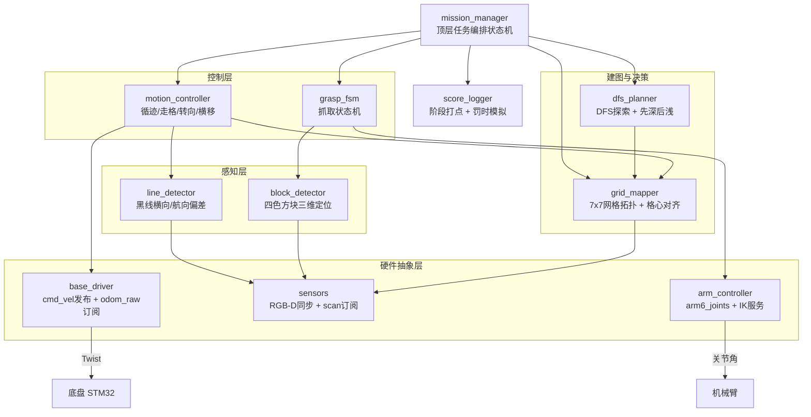

# M3Pro 迷宫自主探索与方块收集系统 — 实施方案

> 配套文档：`AGENTS.md`（环境与接口速查）
> 代码包位置：`/home/jetson/yahboomcar_ws/src/maze_explorer`

---

## 一、总体策略

**分层架构 + 中央状态机编排**：

```
硬件抽象层（底盘/相机/雷达/机械臂）
    ↓
感知层（黑线偏差、方块位姿）
    ↓
建图与决策层（7×7 网格拓扑、DFS 探索）
    ↓
控制层（循迹、走格、转向、抓取）
    ↓
顶层任务编排状态机
```

**不做栅格 SLAM**：2.8m 小场地内麦轮打滑与里程计漂移会让栅格地图糊掉；而场地是**规则 7×7 网格、格心间距 0.4m**，直接用激光测墙构建"格—连通性"拓扑图更可靠、更轻量，也天然匹配"树形迷宫"抽象。SLAM 仅保留作可视化备用。

---

## 二、关键技术决策

### 决策 1：网格化离散运动，而非连续路径规划
格心间距 0.4m 固定，运动离散为三个原语：
- `ADVANCE_ONE_CELL`：沿中线前进一格，到位判据"侧墙对称度 + 开口宽度 + 里程计进距"三取二（路口无前墙，不能只靠前墙）
- `TURN_90`：麦轮原地旋转 90°
- `U_TURN`：死胡同掉头，优先安排在路口，慢速 + 激光守卫（见 §四）

**好处**：误差不累积（每格重新对齐）、状态机简单、易于调试回放。
**代价**：牺牲平滑性；用滑行预检（决策 3）避免每格完全停车。

### 决策 2：机械臂"巡线姿态"与"抓取姿态"分离，抓取前先完成定位
相机装在机械臂第 4 连杆（`DCW2_Joint` 父关节 `arm4`），臂动则视角变。严格约定：

> **巡线姿态下完成方块检测与三维定位 → 记录相对 `base_link` 坐标 → 停车 → 机械臂才动作**

抓取时相机随臂移动属"盲抓"，依赖停车前的定位精度。这是本硬件约束下的必然选择。可复用链路：`color_recognize.py` 的颜色识别 + `grasp.py` 的 `pixel_to_camera_depth` 解算与 IK 调用；`grasp.py` 的 AprilTag 触发部分不可用（决策 4）。

### 决策 3：遇块即抓，而非"先探索完再统一回收"
单块节拍目标 **6~8s**（决策 8 压缩后）；延后回收需二次穿越迷宫，回溯成本远高于就地抓取。采用**探索中遇块即抓 + 深度记账**，仅当方块位置导致无法安全对位（贴墙死角）才登记为待办、回溯时补抓。
检测分两级：**滑行预检**（行进中低频检测，不停）→ 命中才停车做精定位（决策 10），把 49 次逐格停车扫描降为只在方块出现时停车。

### 决策 4：黑线 HSV 必须现场重标，不信任现有配置
现有 `LineFollowHSV.text` = `34, 98, 74, 125, 253, 255`，`V_min=74` 偏高，不符合黑色电工胶布的低明度特征，色相区间也过宽。必须提供标定工具用 `Roi_hsv` 现场框选采样；四色方块阈值同理。
**方块不允许贴任何标记**（已确认）→ 识别路线唯一：颜色 + 深度，无备选。

### 决策 5：新增独立包，零侵入
全部代码放入新建包 `maze_explorer`，不修改任何现有包源码，避免破坏已跑通的 demo。

### 决策 6：探索终点即出口，不回溯到入口
规则为一入口一出口的树。全覆盖、起点=入口、终点=出口的最优巡游长度 = `2×边长和 − dist(入口,出口)`；"DFS 回溯到入口再走向出口"是 `2×边长和 + dist`。**把最后一段回溯改为直奔出口**：DFS 后序遍历以出口格收尾，`RETURN` 只剩"校验出口、驶入判定区域"。省 2×dist(入口,出口)。

### 决策 7：FAULT 的出口是降级返航，不是等待人工
罚时系数未知，但漏到不了出口的块收益为 0、成绩最差。约定：
- 可恢复故障（丢线、单次抓取失败）→ 原地重试，重试上限后登记待办继续；
- 不可恢复故障（碰撞、连续失败、IK 无解）或**截止看门狗触发**（`deadline_margin_s`，可配置）→ 进入 `DEGRADE`：携已收方块沿拓扑最短路驶向出口，放弃剩余目标。
- `DEGRADE` 是终态前的强制路径，任何状态都可跳入。

### 决策 8：机械臂无到位反馈 → `arm6_joints.time` 是唯一计时契约
`Curjoints` 只是 demo 回显指令值，`arm_driver` 无反馈 publisher，`get_kinemarics`(fk) 重算的也是指令。因此：
- 每条关节指令的 `time` 按关节距离自适应（600~1200ms），等待时长 = `time + 150ms`，**禁止** `grasp.py` 式固定 `sleep(2.5/3.5)`（其单块 ≈18.5s）；
- 成功判据用视觉：抓后复查"原位地面无该色块"，而非"睡醒即成功"。

### 决策 9：走廊居中以激光为主，视觉循迹为辅（双模参数化）
激光看 40cm 通道两侧 55cm 挡板做对称居中：不受黑线被方块遮挡、光照、机械臂振动影响；视觉循迹保留作冗余与路口识别，`control_mode: lidar|vision` 可切换。方块压线时的遮挡处理见 `line_detector`（策略：先抓后走）。

### 决策 10：相机→base 外参一次标定，不做实时 FK
`T_base_cam` 在 `LINE_POSE` 下标定一次写入 `arm_poses.yaml`；运行时只查表，不走 `EndToCamMat` + FK 链（少一层误差来源）。定位前停车取 ≥2 帧深度均值（深度仅 10fps、未配准、单帧噪声大）。

---

## 三、性能与复杂度

| 项 | 指标 |
|---|---|
| 巡线控制环 | 20Hz；相机彩色 30fps、深度 10fps，同步后有效 10Hz，足够 0.2m/s 循迹 |
| 图像处理 | 黑线仅扫图像下半部 ROI；全图色块分割；NumPy 向量化，单帧 <5ms |
| 激光处理 | 360 点/帧，开口检测取固定角度扇区均值，O(1) |
| DFS | V=49、E≤84，O(V+E)，可忽略 |
| **主要瓶颈** | **机械臂**：8 块 × 6~8s ≈ 50~65s（决策 8 压缩后） |

**优化手段**：`arm6_joints.time` 自适应计时替代硬编码 sleep（18.5s → 6~8s/块）；"回巡线姿态"与"车体起步"重叠执行（起步期激光居中兜底，视觉恢复后接管），每块再省 2~3s；滑行预检减少逐格停车。

---

## 四、可靠性设计

- `/cmd_vel` 20Hz 持续发布，停止显式发全 0（无超时停车保护）
- 闭环优先订阅 `/odom_raw`（高频）而非 6Hz 的 `/odom`
- 每格到位用激光侧墙对称度 + 开口宽度 + 里程计进距三取二验证，抑制积分漂移（路口无前墙，不能只靠前墙）
- **原地掉头**：优先安排在路口；慢速 ≤0.2rad/s + 激光近距守卫（<8cm 立即停），余量不足改 K 形掉头
- 抓取失败（IK 无解/夹空）自动重试 1 次，二次失败登记待办继续探索，不阻塞
- **降级返航**（决策 7）：不可恢复故障或截止看门狗 → 携已收方块最短路驶向出口
- 碰撞保护：任意方向激光测距低于安全阈值立即停车并回退半格
- 全程 rosbag 录制 `/scan /odom_raw /camera/color/image_raw /cmd_vel`，供离线调参

---

## 五、架构设计



### 主状态机

`INIT`（加载标定、入口对轴校准初始 yaw、臂归巡线姿态）
→ `EXPLORE`（逐格推进、滑行预检、DFS 选向）
→ `DETECT`（发现方块，停车 + 2 帧深度定位）
→ `APPROACH`（车体对位至 0.20m 包络）
→ `GRASP`（臂抓取 → 放入收集筐 → 回巡线姿态）
→ 回 `EXPLORE`
→ **探索以出口格收尾**（决策 6）→ `RETURN`（校验出口、驶入判定区域）
→ `FINISH`

异常 → `FAULT` → 可恢复则重试/登记待办；不可恢复或截止看门狗触发 → **`DEGRADE`**（携已收方块最短路返出口，决策 7）→ `FINISH`

### 出口识别（原方案缺失，已补）
出口判据，三者同时满足才置 `Cell.is_exit = True`：
1. 当前格在 7×7 网格边界（`r∈{0,6}` 或 `c∈{0,6}`）；
2. 朝**场地外**方向的激光扇区是开口：远距/`inf` 射线穿出场地，角宽 ≈ 通道 40cm 对应张角；
3. 不是入口格：与 `INIT` 记录的入口坐标比对（入口同样在边界，靠起点已知区分）。

⚠️ 只靠"边界 + 远距射线"会误判——内部通道同样产生远距射线，必须加"朝外方向 + 排除入口"消歧。如现场出口有视觉标志，作二次确认。出口物理形式见 `AGENTS.md` §8 待验证清单。

---

## 六、目录结构

```
/home/jetson/yahboomcar_ws/src/maze_explorer/
├── package.xml                    # 依赖 rclpy/arm_msgs/arm_interface/sensor_msgs/cv_bridge/message_filters
├── setup.py                       # 节点入口与资源文件
├── config/
│   ├── maze_params.yaml           # 格数7、格距0.40m、车宽0.215m、安全距离、速度限幅、激光扇区与阈值
│   ├── hsv_params.yaml            # 黑线 + 红/绿/黄/蓝 HSV（现场标定后覆盖）
│   └── arm_poses.yaml             # LINE_POSE/GRASP_HOME/PLACE/JOINT6_OPEN|CLOSE、包络0.13~0.25m、目标0.20m、T_base_cam 外参
├── launch/
│   └── maze_bringup.launch.py     # 一键启动，含参数路径与运行时开关
├── maze_explorer/
│   ├── base_driver.py             # 20Hz 发布 Twist；订阅 /odom_raw 提供位姿与 yaw
│   ├── sensors.py                 # ApproximateTimeSynchronizer 同步 color/depth；/scan 按角度扇区取距
│   ├── line_detector.py           # ROI 内 HSV 二值化、行扫描取中心、横向/航向偏差；**方块压线遮挡状态（先抓后走）**；丢线保护
│   ├── block_detector.py          # 四色多目标 + 深度解算（停车≥2帧均值、查表 T_base_cam）+ 滑行预检低频模式
│   ├── grid_mapper.py             # 7×7 格心与四向连通性、激光判定开口、**出口边界开口判据 is_exit**、格心对齐修正
│   ├── dfs_planner.py             # DFS 选向、回溯栈、深度计算、先深后浅队列、**后序遍历以出口为终点**
│   ├── motion_controller.py       # 循迹 PID、ADVANCE_ONE_CELL、TURN_90、**U_TURN（路口优先+激光守卫）**、横移微调、碰撞保护；激光居中/视觉循迹双模
│   ├── arm_controller.py          # 关节下发（**time 自适应计时契约**）、get_kinemarics 调用、位姿与 T_base_cam 查表
│   ├── grasp_fsm.py               # 定位→对位→IK→夹取→放筐→回巡线姿态；**视觉复查成功判据**；失败重试1次
│   ├── mission_manager.py         # 顶层编排；探索/检测/抓取/返航/**DEGRADE 降级返航与截止看门狗**
│   ├── score_logger.py            # 各阶段打点；输出"实际时间+假想罚时"报表，供策略 A/B
│   └── calibration_tool.py        # Roi_hsv 采样黑线与四色、巡线姿态关节角、**T_base_cam 外参**、入口对轴、走格与90°/180°转角自测
└── scripts/
    └── run_maze.sh                # ROS_DOMAIN_ID + source 两工作区 + 关手柄自启 + 启动 bringup + rosbag 录制
```

---

## 七、核心数据结构

```python
# grid_mapper.py / dfs_planner.py 共享
from dataclasses import dataclass, field
from typing import Set, Optional

@dataclass
class Cell:
    r: int                      # 网格行 0..6
    c: int                      # 网格列 0..6
    depth: int = 0              # 树深度（入口为 0），先深后浅排序依据
    open: Set[str] = field(default_factory=set)   # 开口方向 {"N","E","S","W"}
    visited: bool = False
    exhausted: bool = False     # 该格所有分支均已探索完毕
    is_exit: bool = False       # 边界开口判据命中（决策 6/出口识别）

@dataclass
class BlockTarget:
    color: str                  # "red"/"green"/"blue"/"yellow"
    cell_rc: tuple              # 所属格 (r,c)
    depth: int                  # 所在格深度，先深后浅排序依据
    penalty_weight: float = 1.0 # 罚时权重 = f(颜色, 深度)，系数未知时由 yaml 配置，降级取舍依据
    pos_base: tuple             # 停车前测得的相对 base_link 三维坐标 (x,y,z)，米
    yaw: Optional[float] = None # 角点估计的方块朝向，用于 joint5
    state: str = "pending"      # pending / grasping / done / failed
```

```python
# mission_manager.py 顶层状态
from enum import Enum, auto

class MissionState(Enum):
    INIT = auto()        # 加载标定、入口对轴、机械臂归巡线姿态
    EXPLORE = auto()     # 逐格推进 + 滑行预检 + DFS 选向
    DETECT = auto()      # 发现方块，停车 + 2 帧深度定位
    APPROACH = auto()    # 车体对位至抓取包络（目标 0.20m）
    GRASP = auto()       # 机械臂抓取并放入车载收集筐
    RETURN = auto()      # 探索已以出口收尾，此处仅校验出口并驶入判定区域
    DEGRADE = auto()     # 降级返航：携已收方块最短路去出口（决策 7，可从任意状态进入）
    FINISH = auto()
    FAULT = auto()       # 碰撞/丢线/连续抓取失败；可恢复→重试，不可恢复→DEGRADE
```

---

## 八、实施阶段与验收标准

| # | 阶段 | 内容 | 依赖 | 验收标准 |
|---|---|---|---|---|
| 1 | 包骨架与硬件抽象层 | `package.xml`/`setup.py`/`base_driver.py`/`sensors.py`/`arm_controller.py` 骨架 | — | `/cmd_vel` 20Hz 稳定发布；`/odom_raw`/`/scan`/双目话题可收 |
| 2 | 标定工具链 + 三份参数配置 | `calibration_tool.py`，产出 `maze_params.yaml`/`hsv_params.yaml`/`arm_poses.yaml`（含 `T_base_cam`）、入口对轴 | 1 | 四色+黑线 HSV 现场标定通过；入口对轴 yaw 偏差 <2° |
| 3 | 黑线检测与四色方块三维定位 | `line_detector.py`/`block_detector.py`（滑行预检、压线遮挡、2 帧深度） | 2 | 定位重复精度 <2cm；压线方块能进遮挡态 |
| 3' | **最小端到端切片** | 直道走 1 格 → 检测 1 块 → 抓 → 放筐（提前暴露 IK/包络/筐位姿风险） | 2, 3 | 单块全链路 ≤8s；抓取成功（视觉复查通过） |
| 4 | 运动控制与 7×7 网格拓扑建图 | `motion_controller.py`/`grid_mapper.py`（U_TURN、路口到位判据、出口判据） | 1 | 走格横偏 <5cm；路口到位误差 <3cm；掉头不蹭墙 |
| 5 | DFS 探索决策与顶层编排 | `dfs_planner.py`（以出口为终点）/`mission_manager.py`（含 DEGRADE）/`score_logger.py`/`maze_bringup.launch.py` | 3, 4 | mock 传感器单测覆盖全状态迁移；探索终点=出口 |
| 6 | 抓取状态机与收集筐流程完善 | `grasp_fsm.py`、time 自适应计时、重试与降级 | 1, 2, 3' | 一次抓取成功率 >90%；单块节拍 ≤8s |
| 7 | 模拟迷宫联调与全流程实测优化 | 1:1 场地，全流程跑通，按 `score_logger` 报表调优 | 5, 6 | 8/8 收集；全流程目标 ≤7 分钟；DEGRADE 演练通过 |

**阶段 3' 是刻意插入的纵向切片**：IK 可达性、抓取包络、收集筐放置位姿是三个最高风险项，必须在阶段 5 之前暴露。

---

## 九、实施注意事项

- **启动顺序**：`start_agent.sh` → `slam_mapping bringup` → `orbbec_camera` → 自研包（见 `AGENTS.md`）
- **关闭干扰**：运行前关掉 `joy_control/joy.sh` 自启的 `yahboom_joy_M3Pro`
- **速度**：线速度 0.1~0.25 m/s、角速度 0.3~0.6 rad/s；掉头 ≤0.2rad/s
- **标定系数**：沿用 `odom_angular_scale_correction=0.75`、`odom_linear_scale_correction=1.0`，现场复核
- **深度图**：`32FC1`、mm、10fps、未配准 → 必须时间同步 + 内参映射 + 停车 ≥2 帧均值
- **抓取包络**：0.13~0.25m，车体对位目标 0.20m
- **夹爪**：`joint6=30` 张开、`120~140` 夹紧，须实测标定
- **车载收集筐（正式设计条目）**：开口托盘（**出口不卸货**）、宽 ≤21.5cm、高 ≤55cm、带防跳沿；放置位姿入 `arm_poses.yaml`；弯道限角速度防甩出
- **截止看门狗**：`deadline_margin_s` 必须在赛前按场次时限配置，DEGRADE 演练纳入阶段 7
- **日志**：关键状态迁移动 INFO、异常 WARN，**禁止每帧打印**

---

## 十、风险登记表

| 风险 | 影响 | 缓解 |
|---|---|---|
| 原地掉头蹭墙/损毁迷宫 | 直接最差成绩 | 掉头优先路口 + 激光近距守卫 + K 形备选（阶段 4 验收） |
| IK 不可达/包络对不上 | 抓取失败 | 阶段 3' 提前暴露；失败重试 1 次后转待办 |
| 黑线被方块遮挡 | 丢线、卡死 | 压线遮挡态 → 先抓后走；激光居中双模兜底 |
| 罚时系数未知 | 策略取舍失据 | 8 块全收 + `score_logger` 假想罚时做敏感性分析 |
| 无机械臂到位反馈 | 误判成功 | time 计时契约 + 抓后视觉复查 |
| 中途故障到不了出口 | 收益归零 | DEGRADE + 截止看门狗，任意状态可进入 |
